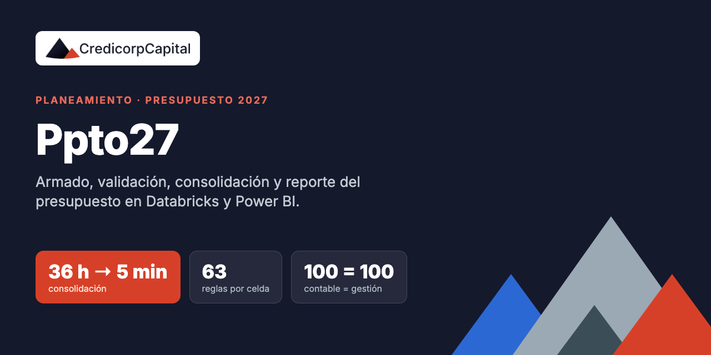
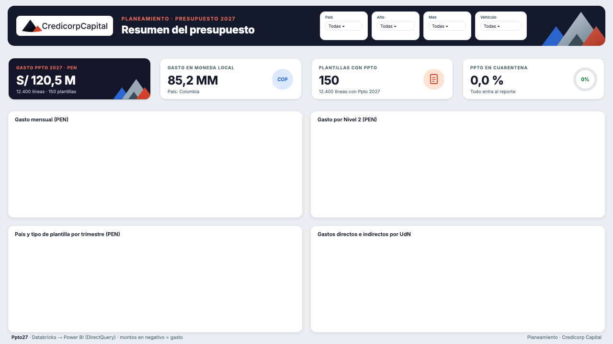
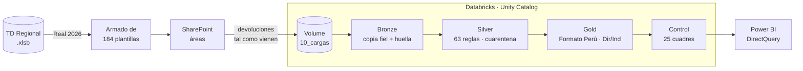

<div align="center">



# Ppto27 · Presupuesto 2027 en Databricks

**Plataforma de Planeamiento de Credicorp Capital para armar, validar, consolidar y reportar el presupuesto 2027.**

[](https://github.com/matiascastill0/planeamiento-presupuesto/actions/workflows/ci.yml)


**De ~36 horas de carga manual a ~5 minutos por corrida.**

</div>

---

## Contenido

- [Impacto](#impacto)
- [Qué resuelve](#qué-resuelve)
- [Arquitectura](#arquitectura)
- [Estructura del repositorio](#estructura-del-repositorio)
- [Cómo empezar](#cómo-empezar)
- [Reglas de negocio](#reglas-de-negocio)
- [Documentación](#documentación)
- [Datos y seguridad](#datos-y-seguridad)
- [Autores](#autores)

## Impacto

| ⏱️ Consolidación | ✅ Validación | 🔁 Reparto | 📊 Reporte |
|:---:|:---:|:---:|:---:|
| **36 h → 5 min** | **63 reglas** por celda | **Mensual** por UdN | **En vivo** |
| ~430× más rápido que el Ppto 2026 | Cada error con su celda exacta | Contable = gestión al céntimo | Una sola versión de la verdad |

| | Ppto 2025 / 2026 | Ppto27 |
|---|---|---|
| Consolidar 184 plantillas | ~36 h (SQL plantilla por plantilla) | ~5 min por corrida |
| Validación | Manual, al final | Automática, en cada carga |
| Indirectos | Anual, solo gasto propio | Mensual, gasto propio + soporte |
| Reporte | Excel consolidado | Power BI DirectQuery |

Comparación completa con los ejercicios anteriores en [docs/antes-vs-ahora.md](docs/antes-vs-ahora.md).



## Qué resuelve

En el Ppto 2026, consolidar el presupuesto significaba subir una por una las plantillas Excel de cada área con un ejecutable SQL: unos 10 minutos por plantilla, 45 las de TI, **~36 horas** en total. Además, no se validaba cada celda ni se repartían los indirectos mes a mes.

Ppto27 automatiza el ciclo completo:

| | Qué hace |
|---|---|
| **Armado** | Genera las **184 plantillas** (por unidad, área o rubro, en 6 países) con el Real 2026 de la TD Regional, cuadradas por país × vehículo × CeCo × cuenta × mes. |
| **Validación** | Revisa cada devolución **celda por celda con 63 reglas**. Cada hallazgo sale con archivo, fila y celda exacta; las líneas con error van a cuarentena sin frenar la carga. |
| **Consolidación** | Arquitectura medallion en Databricks (bronze → silver → gold), con historial de versiones por plantilla. |
| **Reparto Dir/Ind** | Reparte los indirectos por unidad de negocio, país y mes con la metodología nueva, y comprueba que **contable = gestión al céntimo**. |
| **Control** | 25 controles de cuadre antes de publicar (**100 = 100**: lo que suman las plantillas es lo que suma el BI). |
| **Reporte** | Power BI en vivo (DirectQuery) con diseño corporativo y tarjetas KPI. |

## Arquitectura



| Capa | Tabla | Qué guarda |
|---|---|---|
| Bronze | `ppto27_brz_*` | Cada archivo tal como llegó, con su hash (detecta duplicados) y su carga. |
| Silver | `ppto27_slv_*` | Líneas validadas, flags por celda y versión vigente por plantilla (la carga más reciente). |
| Gold | `ppto27_gld_*` | Modelo en estrella para el BI: `fact_ppto`, `fact_gestion_dirind`, `fact_flags` y 12 dimensiones. |
| Control | `ppto27_ctl_*` | Resultado de los 25 controles de cada corrida. |

Más detalle en [docs/arquitectura.md](docs/arquitectura.md).

## Estructura del repositorio

```
.
├── databricks/
│   ├── lib/                  Motor: catálogo de flags, lectura de plantillas, silver, gold y PySpark
│   ├── notebooks/pipeline/   00_setup · 10_bronze · 20_silver · 30_gold · 90_control · 95_validar · 98_restauracion · 99_ejecutar_todo
│   ├── notebooks/demo/       Demo de plantillas limpias y con errores
│   ├── notebooks/flujo-bandeja/  Flujo alternativo con bandeja de entrada
│   ├── celdas/               Celdas para 99_ejecutar_todo (tiempos y reporte de la carga)
│   └── maestros/             Qué maestros se suben al Volume (no versionados)
├── plantillas/               Armado de las plantillas con el Real 2026 (Python local, edición XML)
├── powerbi/                  Tema, fondos, tarjetas KPI SVG y generación del .pbip
├── datos-simulados/          Las 15 tablas del BI con datos simulados (para trabajar sin Databricks)
├── demo/                     Generador de las plantillas de demo y prueba local en Spark
├── herramientas/             Generadores de notebooks, maestros, dashboard y paquetes
└── docs/                     Arquitectura, metodología, modelo de datos, flags, Power BI y guía del proceso
```

## Cómo empezar

### Requisitos

- Python 3.11 con las dependencias de [`requirements.txt`](requirements.txt).
- Para el pipeline: un workspace de Databricks con Unity Catalog y acceso al Volume del proyecto.
- Para el reporte: Power BI Desktop (formato `.pbip` / PBIR).

```bash
git clone https://github.com/matiascastill0/planeamiento-presupuesto.git
cd planeamiento-presupuesto
python -m venv .venv && source .venv/bin/activate     # Windows: .venv\Scripts\activate
pip install -r requirements.txt
```

### 1 · Armar las plantillas (local)

Los scripts esperan la estructura de carpetas del proyecto (`01. Ruta Oficial…`, `02. Insumos`, `03. Procesos`). La raíz se toma de la variable `PPTO27_RAIZ`.

```bash
cd plantillas
python parse_cache_v2.py cache_ago.pkl        # decodifica la caché de la TD Regional
python build_bd.py                             # insumos de homologación
python ruta_v2.py                              # reconstruye las plantillas (o una carpeta: ruta_v2.py "MDK/01. PERU")
python v2_verificar.py                         # cuadre país × vehículo × CeCo × cuenta × mes
```

### 2 · Consolidar en Databricks

El catálogo, el esquema y el Volume **no están en el código**: se configuran por workspace. En el repo aparecen como `catalogo_ppto.esquema_ppto`.

| Variable | Qué es |
|---|---|
| `PPTO27_CATALOGO` / `PPTO27_ESQUEMA` | Catálogo y esquema de Unity Catalog donde se crean las tablas `ppto27_*` |
| `PPTO27_VOLUME` | Ruta del Volume del proyecto (`/Volumes/<catalogo>/<esquema>/<volume>/ppto27`) |
| `DBX_HOSTNAME` | Host del SQL Warehouse, solo para generar el `.pbip` |

1. Subir `databricks/lib/*.py` a `ppto27/00_codigo` y los maestros a `ppto27/90_maestros`.
2. Importar `databricks/notebooks/pipeline` y correr `00_setup`.
3. Subir la carpeta de la carga (`AAAAMMDD_HHMM_…`) a `ppto27/10_cargas`.
4. En `99_ejecutar_todo`, elegir la carga y **Run all**. La última celda muestra los controles y cada hallazgo con su celda.

### 3 · Reportar en Power BI

Abrir el `.pbip` y **Actualizar**. Para aplicar el diseño corporativo y las tarjetas KPI a un `.pbip`, ver [powerbi/README.md](powerbi/README.md).

### Sin acceso a Databricks

[`datos-simulados/`](datos-simulados) tiene las 15 tablas del modelo con la misma estructura y datos de ejemplo coherentes. Se conecta Power BI al Excel y se trabaja igual.

## Reglas de negocio

- **Fuente única:** montos y CeCos salen solo de la TD Regional con filtros oficiales: Real 2026, Vista 1 y 3, sin INTERCOM ni ELIM, con ajustes.
- **Invertir para Crecer (IPC)** queda fuera de todas las plantillas, validaciones y reportes.
- **CeCo siempre real y numerado** (`NNN - Nombre`). Nunca "Varios" de ningún tipo.
- **Cuadre** por país × vehículo × CeCo × cuenta × mes, no solo por país.
- **Gasto en negativo** en el Ppto 2027. Un positivo es un error (cuarentena).
- **Edición de Excel por XML** (lxml), para conservar formatos, nombres definidos y validaciones.

## Documentación

| Documento | Contenido |
|---|---|
| [Antes vs ahora](docs/antes-vs-ahora.md) | Comparación con el Ppto 2025 / 2026: tiempos, proceso, plantilla y reparto |
| [Arquitectura](docs/arquitectura.md) | Capas, cargas, versiones, restauración y controles |
| [Metodología Dir/Ind](docs/metodologia-dir-ind.md) | Directo, bolsa, peso e indirecto, con ejemplo |
| [Modelo de datos](docs/modelo-de-datos.md) | Tablas, columnas, relaciones y medidas del BI |
| [Catálogo de flags](docs/catalogo-flags.md) | Las 63 reglas de validación |
| [Power BI](docs/powerbi.md) | Diseño corporativo, tarjetas KPI y conexión |
| [Guía del proceso](docs/guia-del-proceso.html) | Guía completa para el negocio (abrir en el navegador) |

## Datos y seguridad

**Este repositorio no contiene datos reales:** ni plantillas, ni TD, ni maestros, ni salidas de notebooks, ni archivos de Power BI. La única data incluida es la simulada de `datos-simulados/` y los catálogos sin montos. Ver [SECURITY.md](SECURITY.md) y [CONTRIBUTING.md](CONTRIBUTING.md).

## Autores

Equipo de Planeamiento · Credicorp Capital. Ver [AUTHORS.md](AUTHORS.md).

- Luis Alonso Delgado Quiroz
- Jean Pierre Mendoza Cueva
- Christian Pablo Vila Ramos
- Matias Fernando Castillo Quincho
- Yacomo Rodrigo Poma Rojas

---

<sub>© 2026 Credicorp Capital. Todos los derechos reservados. Uso interno. Ver [LICENSE](LICENSE).</sub>
