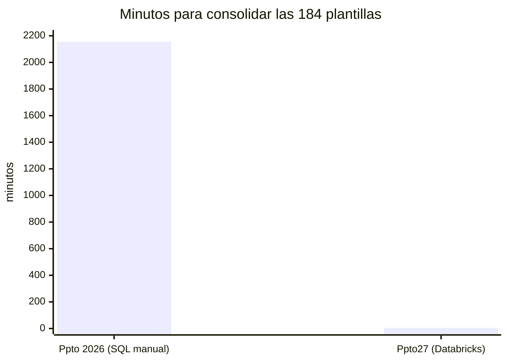
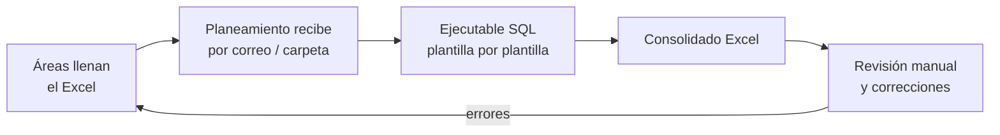
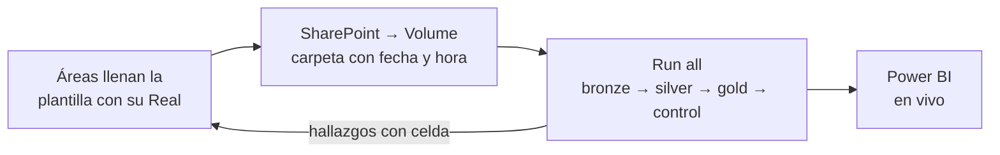

# Antes vs ahora

Cómo se armaba y consolidaba el presupuesto en los ejercicios anteriores (Ppto 2025 y Ppto 2026) y qué cambia con Ppto27.

## En una mirada

| | Ppto 2025 / 2026 | Ppto27 |
|---|---|---|
| **Consolidar las plantillas** | Una por una, con un ejecutable SQL | Una corrida para todas |
| **Tiempo de carga** | ~10 min por plantilla (TI ~45 min) · **~36 h** en total | **~5 min** por corrida |
| **Validación** | Revisión a mano, al final | **63 reglas** celda por celda, en cada carga |
| **Errores** | Se descubrían tarde, sin ubicación precisa | Archivo, fila y **celda exacta**; la línea va a cuarentena sin frenar la carga |
| **Versiones** | "¿Cuál es el archivo bueno?" | Cada carga con fecha y hora; vigente = la más reciente; historial y `RESTORE` |
| **Reparto de indirectos** | Anual, con base solo en el gasto propio | **Mensual**, con base en gasto propio + soporte recibido |
| **Cuadre** | Por país, a mano | **25 controles** automáticos: 100 = 100 y contable = gestión al céntimo |
| **Reporte** | Excel consolidado | **Power BI en vivo** (DirectQuery), una sola versión de la verdad |

## Tiempo de consolidación

| Cálculo Ppto 2026 | Minutos |
|---|---:|
| 9 plantillas de TI × 45 min | 405 |
| 175 plantillas restantes × 10 min | 1,750 |
| **Total** | **2,155 (~36 h, más de 4 jornadas)** |

Ppto27: ~5 minutos por corrida, del orden de **430 veces más rápido**. Además valida, consolida y reparte, cosas que antes no se hacían.

## El proceso

**Antes**

**Ahora**

## La plantilla

| | Formato 2025 (BBDD Planeamiento Financiero) | Plantilla Ppto27 |
|---|---|---|
| Punto de partida | En blanco o con el año anterior copiado a mano | **Prellenada con el Real 2026 Ene–Ago** de la TD, cuadrada por CeCo × cuenta × mes |
| Estructura | 45 columnas, Nivel 1–3 por BUSCARV | 41 columnas fijas (A–AO) en `Tabla1`, validadas por el pipeline |
| CeCo | Código suelto | `NNN - Nombre` real, nunca "Varios" |
| Proveedores | Texto libre | Lista homologada (sin variantes de nombre ni "Ñ" dañada) |
| Listas desplegables | País, UdN, moneda | País, vehículo, CeCo, Nivel 1/2, proveedor y moneda |
| Errores típicos | Signos invertidos, fórmulas rotas, filas fuera de tabla, textos en montos | Los mismos, pero **detectados automáticamente** con su celda |

## Reparto de indirectos

| | Metodología anterior | Metodología nueva |
|---|---|---|
| Base del peso | Solo imputación directa | Imputación + soporte directo |
| Frecuencia | Anual | Mensual |
| Bolsa | Áreas indirectas | Áreas indirectas + sobrante del soporte |
| Verificación | — | Peso × bolsa = indirecto publicado, diferencia 0 |

En las pruebas, la base anterior no reproducía el indirecto publicado; con la base nueva la diferencia es 0 en los 12 meses. Ver [Metodología Dir/Ind](metodologia-dir-ind.md).

## Qué gana el negocio

- **Tiempo:** el equipo pasa de sumar Excel a analizar variaciones y conversar con las áreas.
- **Confianza:** un solo número, el mismo para el área, para Planeamiento y para la gerencia, trazable hasta la celda de origen.
- **Rentabilidad por UdN:** cada unidad absorbe el indirecto que corresponde, mes a mes.
- **Escala:** la misma estructura sirve para intercompanies, el cierre real contra el presupuesto y los forecasts.

---

© 2026 Credicorp Capital. Uso interno. Ver [LICENSE](../LICENSE).
