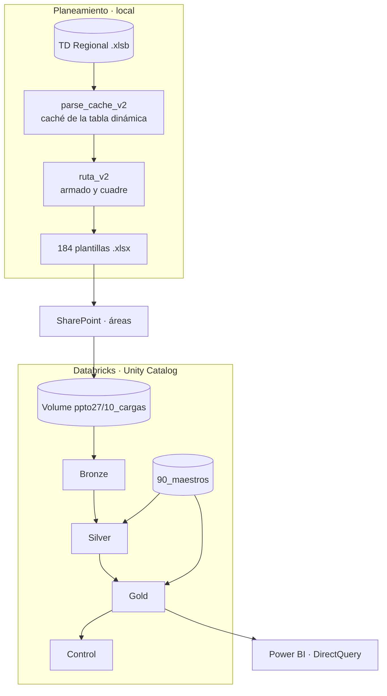
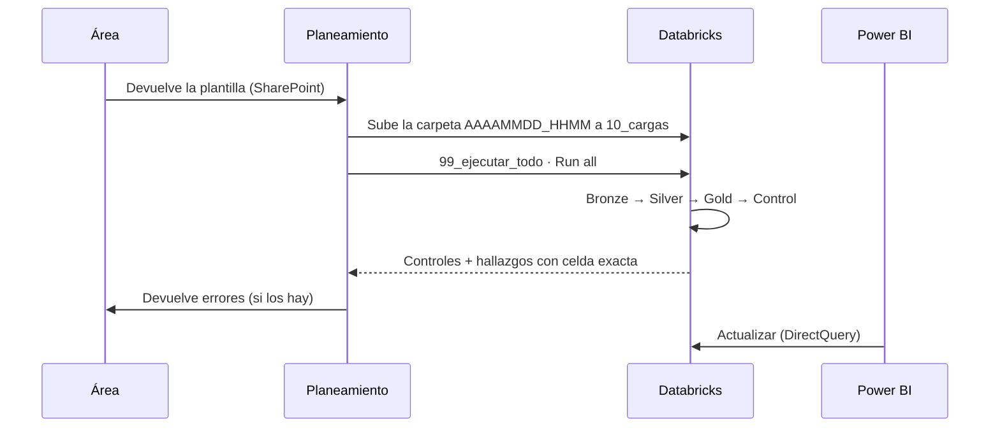

# Arquitectura

## Visión general

## Almacenamiento

- **Catálogo y esquema:** Unity Catalog, tablas Delta con prefijo `ppto27_` (`brz_`, `slv_`, `gld_`, `ctl_`).
- **Volume** `ppto27/`:

| Carpeta | Uso |
|---|---|
| `00_codigo` | Librerías del motor (`databricks/lib`) |
| `10_cargas` | Cada carga en su carpeta `AAAAMMDD_HHMM_<descripción>`, tal como llega de SharePoint |
| `40_tiempos` | Tiempos de cada corrida (JSON) |
| `90_maestros` | Maestros, alias y drivers |

## Capas

### Bronze: recepción

- Lee cada `.xlsx` de la carga y guarda una copia fiel, línea por línea.
- Calcula una **huella (hash)** por archivo: si alguien sube dos veces lo mismo, se marca como REPETIDO y no entra dos veces.

### Silver: calidad

- Aplica las **63 reglas** del [catálogo de flags](catalogo-flags.md) celda por celda: textos, montos, fórmulas, estructura y cambios contra lo que se envió.
- Severidades:
  - **BLOQUEANTE:** rechaza el archivo.
  - **ERROR:** la línea va a cuarentena.
  - **ALERTA:** entra y se revisa.
  - **INFO:** se corrige sola.
- **Versión vigente:** por plantilla se toma la carga más reciente (`carga_id` mayor). Las anteriores quedan en el historial.

### Gold: modelo para el BI

- Convierte monedas (6 países), ordena en **Formato Perú** y arma el modelo en estrella. Ver [Modelo de datos](modelo-de-datos.md).
- Calcula el reparto **Dir/Ind** por UdN, país y mes. Ver [Metodología](metodologia-dir-ind.md).

### Control: auditoría antes de publicar

25 controles de cuadre. Entre ellos:

- lo cargado = contable + cuarentena (100 = 100);
- contable = gestión Dir/Ind por país y mes;
- cada driver de soporte suma 100 %;
- ninguna línea sin CeCo, sin país o sin componente.

## Ciclo de una carga

## Restauración

`98_restauracion` lista los puntos de regreso (versiones Delta) y permite volver una tabla a una versión anterior con `RESTORE`. Sirve, por ejemplo, para deshacer una carga equivocada.

## Tiempos

| | Ppto 2026 (SQL manual) | Ppto27 |
|---|---|---|
| Por plantilla | ~10 min (TI ~45 min) | segundos |
| 184 plantillas | ~36 h | ~5 min por corrida |
| Validación por celda | No | 63 reglas |
| Reparto Dir/Ind mensual | No | Sí, cuadrado al céntimo |

---

© 2026 Credicorp Capital. Uso interno. Ver [LICENSE](../LICENSE).
