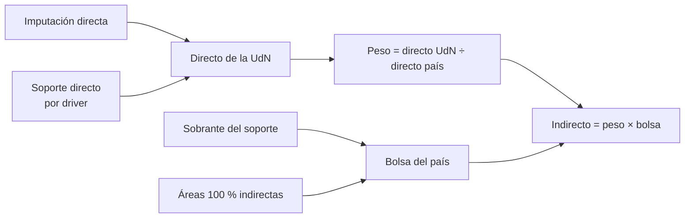

# Metodología Dir/Ind

El reparto de indirectos define cuánto gasto corporativo absorbe cada unidad de negocio (UdN) y, por lo tanto, su rentabilidad. Se calcula **por país y por mes**.

## Componentes

| Id | Componente | Grupo | De dónde sale |
|---|---|---|---|
| 1 | Imputación directa | Directo | Gasto de CeCos de negocio de la UdN (plantillas UdN) |
| 2 | Soporte directo | Directo | Parte del gasto de un área de soporte que su **driver** asigna a una UdN |
| 3 | Indirecto asignado | Indirecto | Parte de la **bolsa** que recibe la UdN según su peso |

## Los tres pasos

1. **Directo** de cada UdN = imputación directa + soporte directo.
2. **Bolsa** del país = lo que sobró del soporte directo (la parte de los drivers que no va a una UdN) + el gasto de las áreas 100 % indirectas.
3. **Peso** de la UdN = su directo ÷ el directo total del país, en ese mes.
   **Indirecto** de la UdN = peso × bolsa.

## Ejemplo (un país, un mes)

| UdN | Imputación | Soporte directo | Directo | Peso | Indirecto (bolsa = 300) |
|---|---:|---:|---:|---:|---:|
| WM | 500 | 50 | 550 | 55 % | 165 |
| AM | 300 | 50 | 350 | 35 % | 105 |
| MDK | 90 | 10 | 100 | 10 % | 30 |
| **Total** | **890** | **110** | **1,000** | **100 %** | **300** |

El reparto **no crea ni destruye gasto**: contable del país = directo + indirecto.

## Metodología anterior vs nueva

| | Anterior | Nueva |
|---|---|---|
| Base del peso | Solo imputación directa | Imputación + soporte directo |
| Bolsa | Áreas indirectas | Áreas indirectas + sobrante del soporte |
| Lógica | La UdN paga según su gasto propio | La UdN que consume más soporte también absorbe más indirecto |

`fact_gestion_dirind` guarda las dos metodologías (columna `metodologia`). En el BI se filtra **una sola**: si no, el total sale duplicado.

## Controles

- **Peso × bolsa = indirecto publicado**, diferencia 0 por UdN y mes.
- **Contable = directo + indirecto** por país y mes, para cada metodología.
- **Cada driver suma 100 %.**
- **CeCos de soporte sin driver** y **países sin base de reparto** quedan identificados para revisión, sin perderse.

---

© 2026 Credicorp Capital. Uso interno. Ver [LICENSE](../LICENSE).
