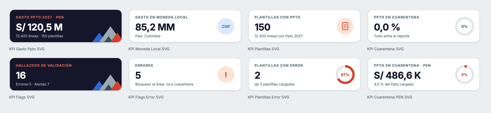

# Power BI

## Conexión

El reporte lee las tablas gold (`ppto27_gld_*`) de Databricks en **DirectQuery**: lo que publica el pipeline se ve al **Actualizar**, sin copias intermedias.

1. En Databricks: **SQL Warehouses → (warehouse) → Connection details**. Copiar *Server hostname* y *HTTP path*.
2. En Power BI Desktop: **Obtener datos → Azure Databricks** → pegar ambos datos → **DirectQuery**.
3. Autenticarse con la cuenta corporativa (Microsoft Entra ID).
4. Elegir el catálogo y el esquema del proyecto, y marcar las tablas `ppto27_gld_*`.

`powerbi/generar_pbip.py` arma el `.pbip` completo. El host se pasa por la variable `DBX_HOSTNAME` y nunca se versiona.

## Páginas

| Página | Contenido |
|---|---|
| Resumen | Tarjetas KPI, gasto mensual, gasto por Nivel 2, directos e indirectos por UdN |
| Contable / Gestión | Matriz Formato Perú por mes, con selector de moneda |
| Dir-Ind (UdN) | Directos e indirectos por UdN, país y metodología |
| Detalle CeCo | Gasto por agrupación y CeCo, detalle por cuenta y proveedor |
| Calidad | Flags por tipo, detalle con celda exacta y tarjetas de calidad |

Filtros sincronizados entre páginas: País, Año, Mes y **Vehículo** (no está en Calidad, porque los flags no tienen vehículo).

## Diseño corporativo

Usa la paleta de la guía del proceso (azul noche `#15192C`, coral `#D74028`, azul `#2F71E5`, gris `#ECEFF1`), la tipografía Inter y un estilo limpio: tarjetas blancas redondeadas con sombra suave.

| Pieza | Script | Qué hace |
|---|---|---|
| Tema | `powerbi/tema/tema-ppto27.json` | Colores, fuentes, tablas, segmentadores y gráficos |
| Fondos | `powerbi/generar_diseno_bi.py` | PNG por página con banda, logo, título y montañas (Chrome headless) |
| Aplicar a un `.pbip` | `powerbi/disenar_pbip.py` | Tema, fondos, grilla de 16 px y filtro Vehículo sincronizado |
| Tarjetas KPI | `powerbi/kpis_svg.py` | 8 medidas DAX que dibujan tarjetas SVG y las colocan en Resumen y Calidad |

```bash
python powerbi/disenar_pbip.py "<carpeta con el .pbip>" "<carpeta de salida>"
python powerbi/kpis_svg.py "<carpeta de salida>"
```


### Tarjetas KPI en SVG

Son medidas DAX que devuelven un `data:image/svg+xml` con categoría **URL de imagen**, mostradas en una tabla de una celda. Son nativas: no necesitan visuales de terceros, funcionan en el Service y con DirectQuery, y responden a los filtros.



Para cambiar textos, colores o umbrales, se edita la medida (carpeta *5 Diseño KPI*). Por ejemplo, el semáforo de cuarentena usa `_p = 0` verde, `_p <= 0.02` ámbar y coral por encima.

> La fuente Inter se ve si está instalada en el equipo de quien mira. Si no, Power BI usa Segoe UI automáticamente. Los títulos de los fondos van en Inter porque son imagen.

---

<sub>© 2026 Credicorp Capital. Uso interno. Ver [LICENSE](../LICENSE).</sub>
